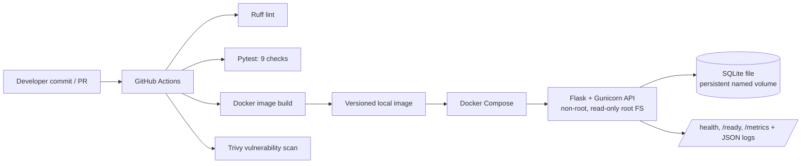

# Apex Operations API — Junior DevOps Practical Assessment

A small, reproducible local service demonstrating containerization, CI quality gates, versioned releases, rollback, basic observability, and operational documentation. Uses synthetic data only.

## Architecture



## Prerequisites

- Docker Desktop with WSL 2 integration enabled, or Docker Engine + Compose v2.
- Git and (optional, for running tests on the host) Python 3.12.
- A GitHub repository to run the hosted CI workflow. No cloud account or paid service is needed.

## Run locally with Docker Compose

```bash
cp .env.example .env   # optional; defaults work without this file
docker compose up --build -d
docker compose ps
curl -i http://localhost:8080/health
curl -i http://localhost:8080/ready
curl -s http://localhost:8080/metrics
```

Create and list a synthetic operation:

```bash
curl -sS -X POST http://localhost:8080/api/v1/operations \
  -H 'Content-Type: application/json' \
  -d '{"name":"synthetic smoke test"}'
curl -sS http://localhost:8080/api/v1/operations
```

View logs and stop the service:

```bash
docker compose logs --tail=100 -f api
docker compose down
```

The named `api_data` volume persists SQLite data across container replacement. To remove the volume and all local demo records intentionally, run `docker compose down -v`.

## Run checks locally

```bash
python3 -m venv .venv
source .venv/bin/activate
pip install -r requirements-dev.txt
ruff check app tests
pytest -q
```

The normal suite includes nine checks for health, readiness, create/list validation, malformed input, unknown routes, metrics, and request IDs. The separate `tests/intentional_failure_case.py` is a deliberate negative test fixture and is not included in the normal suite. Demonstrate the quality gate with:

```bash
pytest -q tests/intentional_failure_case.py
# Expected: non-zero exit code because the assertion is intentionally false.
```

Do not change the CI step to treat an ordinary product-test failure as success. The CI negative-test step succeeds only if the intentionally broken fixture is detected as failing.

## Versioned release and rollback

Create a versioned image and deploy it:

```bash
./scripts/deploy.sh v1
```

Deploy a second version after changing the app or image tag:

```bash
./scripts/deploy.sh v2
```

Rollback to a previously built, known-good image tag:

```bash
docker images apex-ops-api
./scripts/rollback.sh apex-ops-api:v1
```

The rollback script refuses to run if the requested image does not exist locally, applies the selected image through Compose, then polls `/ready`. A production-grade remote deployment would additionally keep immutable registry tags/digests and deployment history; this assessment intentionally remains local-only.

## CI pipeline

`.github/workflows/ci.yml` runs on pushes to `main`, pull requests, and manual dispatch. It installs pinned Python dependencies, runs Ruff and Pytest, verifies the intentional-failure fixture is caught, builds the container, and runs Trivy against the image. The workflow must pass before a release is considered eligible. The workflow does not deploy to a production environment.

## Security and configuration decisions

- Container runs as UID/GID 10001, not root.
- Compose sets a read-only root filesystem, drops Linux capabilities, enables `no-new-privileges`, and uses a small `tmpfs` for temporary files.
- No credentials are required. `.env.example` contains non-secret defaults; `.env` is ignored by Git. For a cloud deployment, use the platform's secret manager and inject secrets at runtime; never bake them into an image or print them in logs.
- Dependencies are pinned. CI runs Trivy and fails on detected unfixed/high or critical vulnerabilities; review findings before changing the policy.
- API accepts only a bounded operation name and uses parameterized SQLite queries.
- The API is exposed on localhost port 8080 by default. Do not expose it publicly without TLS, authentication/authorization, rate limiting, and a threat review.

## Observability and incident drill

- `/health`: process-level liveness response.
- `/ready`: verifies the SQLite dependency can be queried.
- `/metrics`: Prometheus text exposition for request count, 5xx count, and process uptime.
- Logs: JSON-formatted application logs include HTTP method, path, status, duration, and request ID. Avoid adding request bodies or secrets to logs.

Simulate an incident by stopping the container, then investigate and recover:

```bash
docker compose stop api
curl -i http://localhost:8080/ready   # expected connection failure while stopped

docker compose ps
docker compose logs --tail=100 api
docker compose start api
curl -i http://localhost:8080/ready
```

For an HTTP-level failure drill, request an unknown route and inspect the JSON 404 and `X-Request-ID` response header. Do not claim screenshots or CI results until you capture them from your own run.

## Cost-aware cloud path

For a small low-traffic deployment, a single small managed container service plus managed database can reduce operational burden. Compare monthly baseline, egress, logs/metrics retention, backup, and minimum instance costs before choosing a provider. Keep the container stateless except for the attached data volume; for a real multi-replica service, replace SQLite with managed PostgreSQL and add authentication, migrations, backups, and restore tests. No cloud resources are created by this project.

## Submission evidence checklist

- [ ] Screenshot/log of successful normal test run and Ruff output.
- [ ] GitHub Actions run showing lint, tests, image build, and image scan results.
- [ ] `docker compose ps` plus `/health` and `/ready` responses.
- [ ] Logs from the incident drill and recovery.
- [ ] Evidence of two image tags and a successful rollback to the earlier tag.
- [ ] Final commit hash and a ZIP/repository link.

## AI-use disclosure

AI assistance was used to draft the initial project structure, API/test examples, CI workflow, operational scripts, and documentation. The candidate must personally run the project, inspect and modify the code, verify the test/build/scan outputs, capture genuine evidence, and be prepared to explain each design choice. Do not submit unverified results as completed evidence.
